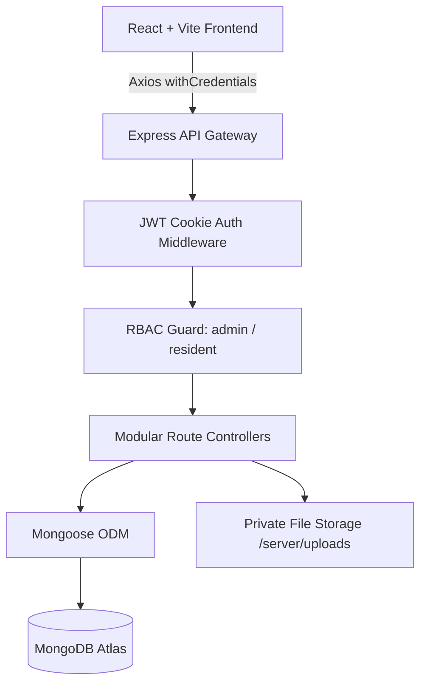

# 🏢 FlatFlow — Society Maintenance Management & Payment Platform

[](https://mongodb.com)
[](https://www.mongodb.com/cloud/atlas)
[](https://nodejs.org/)
[](https://react.dev/)
[](https://opensource.org/licenses/ISC)

> **FlatFlow** is a comprehensive, production-ready MERN-stack web application designed for residential housing societies to automate maintenance billing, record verifiable payments, resolve resident disputes, and track collection analytics in real time.

---

## 📌 Table of Contents

- [Overview](#-overview)
- [Key Features](#-key-features)
- [System Architecture](#-system-architecture)
- [Technology Stack](#-technology-stack)
- [Database Models](#-database-models)
- [API Reference](#-api-reference)
- [Project Structure](#-project-structure)
- [Getting Started](#-getting-started)
  - [Prerequisites](#prerequisites)
  - [Installation](#installation)
  - [Environment Configuration](#environment-configuration)
  - [Database Seeding](#database-seeding)
  - [Running Locally](#running-locally)
- [Default Demo Credentials](#-default-demo-credentials)
- [Security & Architecture Highlights](#-security--architecture-highlights)
- [Author & Acknowledgments](#-author--acknowledgments)

---

## 📖 Overview

Housing societies frequently suffer from disjointed maintenance tracking: scattered paper ledgers, untracked bank transfers, forgotten dues, and delayed billing inquiries.

**FlatFlow** provides a unified portal with dedicated, role-protected workflows:
1. **For Residents**: View monthly maintenance charges, pay securely online, download verifiable tax-compliant receipts, raise documented billing disputes, and receive automated reminders.
2. **For Society Administrators & Treasurers**: Generate batch maintenance bills in 1-click with duplicate-period prevention, customize individual flat billing with adjustment reasons, manage occupancy records, resolve billing inquiries, and track financial collection trends.

---

## ✨ Key Features

### 🔐 1. Authentication & Role-Based Authorization
- **Dual Role System**: Strict isolation between `resident` and `admin` portals.
- **Secure Sessions**: Token stored in **`HttpOnly`, `SameSite` secure cookies** with JWT signature verification, protecting against XSS attacks.
- **Bcrypt Password Encryption**: Industry-standard salt hashing with `select: false` security guards.
- **Flexible Onboarding**: Self-registration for residents with flat selection, and admin-controlled resident onboarding with edit permissions.

### 🧾 2. Maintenance Billing Engine
- **Batch Generation**: 1-click automated monthly maintenance generation across all occupied society flats.
- **Duplicate Prevention**: Compound database index `{ flat: 1, billingPeriod: 1 }` strictly prevents duplicate billing for the same month.
- **Individual Flat Bill Generator**: Add one-off adjustments (penalties, facility charges, credits) with mandatory audit reasons.
- **Overdue Management**: Automated status transition to `overdue` when dues pass the cutoff date.
- **Due Date Reminders**: 1-click notification dispatch to all residents with pending balances on the final due date.

### 💳 3. Payments & Audit Receipts
- **Checkout Modal**: Simulated/gateway payment workflow supporting UPI, Debit/Credit Card, and Net Banking.
- **Server Verification**: Server-side amount validation preventing tampering of payment totals.
- **Payment History Ledger**: Complete transaction history with receipt numbers, dates, methods, and status.
- **Printable Official Receipts**: Dedicated `/receipt/:id` page styled with society header, transaction audit stamps, and CSS print media queries.
- **Printable Invoices**: Dedicated printable invoice page (`/bill/:id/print`) for hard-copy recordkeeping.

### ⚖️ 4. Billing Disputes & Private File Uploads
- **Structured Dispute Workflow**: Residents can contest bills with priority tagging (`Low`, `Medium`, `High`) and written descriptions.
- **Document Evidence**: Residents can upload photos or PDF receipts via Multer.
- **Private Document Streaming**: Evidence files are stored outside public directories and served exclusively via authenticated, role-verified routes.
- **Lifecycle Management**: Status progression from `open` → `under_review` → `resolved` / `rejected` with admin resolution notes.

### 🔔 5. Notifications & Alerts
- **Interactive Navbar Bell**: Live unread badge count with instant dropdown preview.
- **Event-Driven Alerts**: Triggered automatically on payment receipt confirmations, dispute status reviews, and admin due date reminders.

### 📊 6. Society Financial Analytics & Reporting
- **Executive KPI Cards**: Total society flats, occupancy rate, total amount billed, total collections, outstanding balance, and overdue counts.
- **6-Month Collection Trend**: Visual bar breakdown comparing monthly billed maintenance vs. actual collections.
- **Top Defaulters Table**: Sorted ledger identifying flats with overdue maintenance for targeted follow-up.

---

## 🏗️ System Architecture



---

## 🛠️ Technology Stack

| Layer | Technologies |
| :--- | :--- |
| **Frontend** | React 19, React Router v7, Axios, Modern Responsive CSS System |
| **Backend** | Node.js (v24+), Express.js (ES Modules), Cookie-Parser, CORS |
| **Database** | MongoDB Atlas, Mongoose 8 (Compound Indexes, Schemas, Population) |
| **Authentication** | JSON Web Tokens (JWT), Bcrypt.js, HttpOnly Secure Cookies |
| **File Handling** | Multer (Multipart/form-data with mime-type validation & private streaming) |
| **Tooling** | Vite 8, Nodemon, Git |

---

## 🗄️ Database Models

- **User**: Name, email, hashed password, role (`admin` | `resident`), flat reference, phone number, status (`active` | `inactive`).
- **Flat**: Wing, flat number, floor, status (`occupied` | `vacant`), owner name, contact number, base maintenance amount.
- **Bill**: Flat reference, billing period (`YYYY-MM`), billing period name, issue date, due date, base amount, adjustments, adjustment reason, total amount, status (`unpaid` | `paid` | `overdue`), payment reference.
- **Payment**: Bill reference, flat reference, user reference, receipt number, amount, payment method, transaction ID, status (`success`).
- **Dispute**: Bill reference, resident reference, flat reference, dispute number, subject, description, priority (`low` | `medium` | `high`), status (`open` | `under_review` | `resolved` | `rejected`), evidence file path, admin response.
- **Notification**: User reference, title, message, type (`payment` | `dispute` | `reminder` | `system`), link, read status (`true` | `false`).

---

## 🔌 API Reference

### Authentication (`/api/auth`)
| Method | Endpoint | Access | Description |
| :--- | :--- | :--- | :--- |
| `POST` | `/api/auth/login` | Public | Authenticates user and issues HttpOnly JWT cookie |
| `POST` | `/api/auth/register` | Public | Self-registration for residents with flat linking |
| `GET` | `/api/auth/flats` | Public | Retrieves available flats for resident registration |
| `POST` | `/api/auth/logout` | Public | Clears authentication cookie |
| `GET` | `/api/auth/me` | Authenticated | Fetches current user profile and flat details |

### Administration (`/api/admin`)
| Method | Endpoint | Access | Description |
| :--- | :--- | :--- | :--- |
| `GET` | `/api/admin/flats` | Admin | Search, filter, and list all society flats |
| `POST` | `/api/admin/flats` | Admin | Create a new flat unit |
| `PUT` | `/api/admin/flats/:id` | Admin | Update existing flat details & occupancy |
| `GET` | `/api/admin/residents` | Admin | Search, filter, and list all registered residents |
| `POST` | `/api/admin/residents` | Admin | Onboard and assign resident to flat |
| `PUT` | `/api/admin/residents/:id` | Admin | Update existing resident profile & flat assignment |

### Billing (`/api/bills`)
| Method | Endpoint | Access | Description |
| :--- | :--- | :--- | :--- |
| `GET` | `/api/bills/my-bills` | Resident | List bills for authenticated resident's flat |
| `GET` | `/api/bills/admin/all` | Admin | Search, filter, and view all society bills |
| `POST` | `/api/bills/admin/generate-batch` | Admin | 1-click monthly billing across occupied flats |
| `POST` | `/api/bills/admin/generate-single` | Admin | Generate customized bill for a specific flat |
| `POST` | `/api/bills/admin/send-reminders` | Admin | Dispatch due date reminder notifications |
| `GET` | `/api/bills/:id` | Resident/Admin | Get specific bill details for printing/viewing |

### Payments & Receipts (`/api/payments`)
| Method | Endpoint | Access | Description |
| :--- | :--- | :--- | :--- |
| `POST` | `/api/payments/checkout` | Resident | Process bill payment and create official receipt |
| `GET` | `/api/payments/my-payments` | Resident | Retrieve payment history and receipts |
| `GET` | `/api/payments/receipt/:id` | Resident/Admin | Fetch verified payment receipt details |

### Disputes (`/api/disputes`)
| Method | Endpoint | Access | Description |
| :--- | :--- | :--- | :--- |
| `GET` | `/api/disputes/my-disputes` | Resident | List all disputes raised by resident |
| `POST` | `/api/disputes` | Resident | Submit new dispute with evidence upload |
| `GET` | `/api/disputes/admin/all` | Admin | Filter & sort disputes by priority and status |
| `PATCH` | `/api/disputes/admin/:id` | Admin | Update dispute status and submit resolution note |
| `GET` | `/api/disputes/evidence/:filename` | Authenticated | Securely stream uploaded evidence document |

### Analytics & Notifications
| Method | Endpoint | Access | Description |
| :--- | :--- | :--- | :--- |
| `GET` | `/api/analytics/admin-summary` | Admin | Fetch society-wide financial KPIs and collection trends |
| `GET` | `/api/notifications` | Authenticated | Retrieve user notifications and unread count |
| `PATCH` | `/api/notifications/:id/read` | Authenticated | Mark a notification as read |
| `PATCH` | `/api/notifications/mark-all-read` | Authenticated | Mark all notifications as read |

---

## 📁 Project Structure

```text
FlatFlow/
├── client/                      # React Frontend (Vite)
│   ├── public/                  # Static assets & SVG favicon
│   ├── src/
│   │   ├── components/          # Reusable UI (Navbar, PaymentModal, NotificationBell, etc.)
│   │   ├── context/             # AuthContext (state, login, register, session restore)
│   │   ├── pages/               # Page Views:
│   │   │   ├── LoginPage.jsx
│   │   │   ├── ResidentDashboard.jsx
│   │   │   ├── ResidentBillsPage.jsx
│   │   │   ├── PaymentHistoryPage.jsx
│   │   │   ├── ReceiptPage.jsx
│   │   │   ├── BillPrintPage.jsx
│   │   │   ├── ResidentDisputesPage.jsx
│   │   │   ├── AdminDashboard.jsx
│   │   │   ├── AdminFlatsPage.jsx
│   │   │   ├── AdminResidentsPage.jsx
│   │   │   ├── AdminBillsPage.jsx
│   │   │   └── AdminDisputesPage.jsx
│   │   ├── services/            # Axios API instance with withCredentials: true
│   │   ├── utils/               # Date formatters (dd-mm-yyyy standard)
│   │   ├── App.jsx              # Client routing & ProtectedRoute guards
│   │   ├── index.css            # Unified FlatFlow design system
│   │   └── main.jsx             # React entry point
│   ├── index.html               # Main HTML template with FlatFlow title & badge
│   ├── package.json
│   └── vite.config.js
│
├── server/                      # Express Backend (ES Modules)
│   ├── src/
│   │   ├── config/              # MongoDB connection setup
│   │   ├── controllers/         # Business logic (auth, admin, bill, payment, dispute, analytics)
│   │   ├── middleware/          # JWT protect, adminOnly, error handler
│   │   ├── models/              # Mongoose schemas (User, Flat, Bill, Payment, Dispute, Notification)
│   │   ├── routes/              # Express API route modules
│   │   └── utils/               # JWT generator, seedData utility, dateFormatter
│   ├── uploads/                 # Private dispute evidence storage (.gitkeep)
│   ├── .env.example             # Environment template
│   ├── package.json
│   └── server.js                # Server entry point
│
├── .gitignore                   # Root gitignore (protects secrets, uploads, node_modules)
├── package.json                 # Monorepo management scripts
└── README.md                    # Project documentation
```

---

## 🚀 Getting Started

### Prerequisites
- **Node.js**: v18.0.0 or higher (v24 recommended)
- **npm**: v9.0.0 or higher
- **MongoDB**: Active MongoDB Atlas cluster URI or local MongoDB daemon

### Installation

Clone the repository and install dependencies for both the frontend and backend:

```bash
git clone https://github.com/Shreya-S-Jadhav/FlatFlow-End-Term-Project-MERN.git
cd FlatFlow-End-Term-Project-MERN

# Install all dependencies with single root command
npm run install:all
```

### Environment Configuration

Create a `.env` file in the `server/` directory:

```bash
cp server/.env.example server/.env
```

Fill in your configuration variables in `server/.env`:

```env
PORT=5000
NODE_ENV=development
CLIENT_URL=http://localhost:5173

# MongoDB Atlas Connection URI
MONGODB_URI=mongodb+srv://<username>:<password>@cluster.mongodb.net/flatflow?retryWrites=true&w=majority

# JWT Authentication
JWT_SECRET=your_super_secret_jwt_key_here_change_in_production
JWT_EXPIRES_IN=7d
```

### Database Seeding

Populate the database with initial flats, demo accounts, sample maintenance bills, payments, and disputes:

```bash
npm run seed
```

### Running Locally

You can run both client and server concurrently or in separate terminals:

```bash
# Terminal 1: Start Backend API (Port 5000 with nodemon)
npm run server

# Terminal 2: Start Frontend Client (Vite dev server)
npm run client
```

Open your browser at `http://localhost:5173` to access the application.

---

## 🔑 Default Demo Credentials

The login page features 1-click **Quick Demo** credential buttons for instant testing:

| Role | Email Address | Password | Associated Entity |
| :--- | :--- | :--- | :--- |
| **Society Admin** | `admin@flatflow.com` | `admin123` | Full Society Management Privileges |
| **Resident** | `resident.a101@flatflow.com` | `resident123` | Wing A - Flat 101 |
| **Resident** | `priya@flatflow.com` | `resident123` | Wing A - Flat 102 |

---

## 🔒 Security & Architecture Highlights

1. **HttpOnly Cookie Authentication**: Prevents JavaScript theft of authentication tokens via `document.cookie` (immune to client-side XSS extraction).
2. **Compound Unique Database Indexes**: Ensures duplicate maintenance charges cannot be created for the same flat in the same billing cycle even under concurrent requests.
3. **Strict Data Isolation**: Residents are restricted strictly to bills, disputes, and receipts associated with their assigned flat ID.
4. **Private Document Streaming**: Evidence files attached to disputes are stored in non-static directories and streamed only after validating user identity and role.
5. **Verified Date Standardization**: Standardized `dd-mm-yyyy` date formatting throughout the application prevents timezone mismatch discrepancies.

---

## 👩‍💻 Author & Acknowledgments

- **Author**: Shreya Jadhav
- **Project**: MERN Stack End-Term Project
- **Domain**: Housing Society Maintenance & Financial Management
- **Repository**: [FlatFlow-End-Term-Project-MERN](https://github.com/Shreya-S-Jadhav/FlatFlow-End-Term-Project-MERN)
